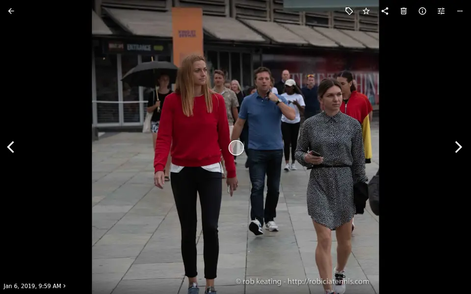
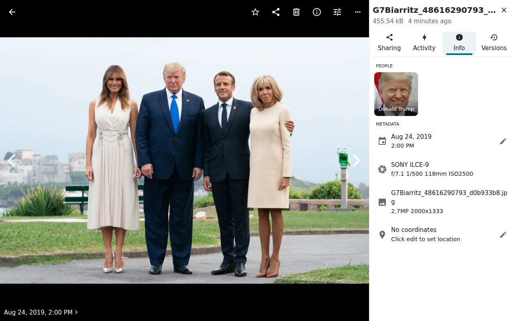
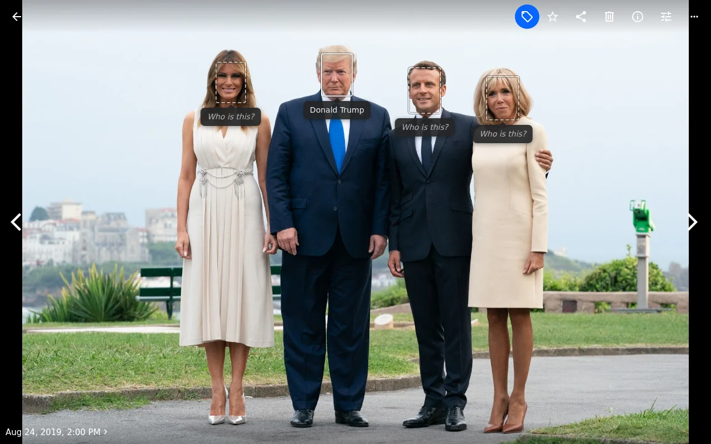
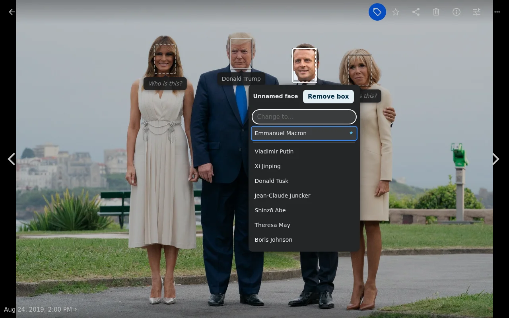

# Manual face tags for Nextcloud Memories

A Nextcloud app that adds Facebook-style manual face tagging to the [Memories](https://github.com/pulsejet/memories) photo viewer, on top of [Recognize](https://github.com/nextcloud/recognize)'s face recognition, plus a second detection pass that finds the faces Recognize misses.
It addresses recognize issue [#611](https://github.com/nextcloud/recognize/issues/611).

Recognize misses a lot of faces in group photos: it detects on a 1024px preview, drops any face it scores under 0.9 or that is tilted more than 30°, and never revisits a photo once it has found a face in it.
On one 12-person group photo it kept 8.



| Memories and Recognize alone | With this app, after its scan, tagging on |
|---|---|
|  |  |
| Four people, one of them named; Recognize never found the other three faces. | The second man's face, found by the scan, waits as "Who is this?"; tapping it ranks the likeliest people first (★): |



<sub>Real Memories 11 and Recognize 12 in the test stack; regenerate with [`tests/readme-media/capture.py`](tests/readme-media/capture.py). Photos: [G7 Biarritz](https://commons.wikimedia.org/wiki/File:-G7Biarritz_(48616290793).jpg) and [State Dinner](https://commons.wikimedia.org/wiki/File:State_Dinner_-_The_Official_State_Visit_of_France_(26832278157).jpg), The White House, public domain, via Wikimedia Commons; names come from the photos' Commons descriptions.</sub>

## What you get

**Tagging in the viewer.**
Open a photo in Memories and press the tag button in the viewer's top bar; it turns blue while tagging is on.

- Every face already on the photo shows a box and a name; faces Recognize found but nobody named are dashed, with "Who is this?".
- **Tap or click a face** to tag someone.
  A fixed-size square appears; the app looks for a face under it with Recognize's own model, snaps the square onto it if it finds one, and puts the most likely people at the top of the list (★).
  Below that is every named person, filtered as you type; a name that doesn't exist yet creates that person.
- **Tap a tag** to change who it is, or to remove it.
- **Tagging stays on while you browse**: swipe, the arrows, the arrow keys and zoom (pinch, wheel, drag) all work as usual, also when they start on a face, and each photo shows its tags as it comes up.
  It stays on across closing and reopening the viewer too (remembered per browser), until you press the tag button again or Esc.

Tags are ordinary Recognize face detections, so they appear in Memories' People views like any other face.

**A second pass over the library** (`occ memories_facetag:scan`, or the background job).
It looks at every photo again at 2048px, keeps faces from score 0.8, skips the roll check (it misfires on small faces), and adds only faces that don't overlap one already there.
A new face whose nearest named person is a clear match is put under that person; the rest go in unassigned for Recognize's clustering to place, and show up as "Who is this?" in tagging mode.

## Requirements

- Nextcloud <!--tested:nextcloud-->34<!--/tested-->, with Memories <!--tested:memories-->11<!--/tested--> and Recognize <!--tested:recognize-->12<!--/tested-->, face recognition enabled and running on Recognize's **tfjs-node** backend (not the pure-JS/WASM fallback).
- The app runs Recognize's bundled `node` and models; it ships no models of its own.

## Installing

It is not in the App Store. Copy `appinfo lib js css bin` into `custom_apps/memories_facetag` and enable it:

```sh
occ app:enable memories_facetag
```

If Nextcloud runs in Docker, `./deploy` does that (container name in `CONTAINER`, default `nextcloud`), and runs `occ upgrade` when the version changes.

⚠️ Because it is not from the App Store, `occ app:update` leaves it alone — but would replace it if an App Store app ever took the id `memories_facetag`.

## The library scan

Try it on one folder first:

```sh
occ memories_facetag:scan --user alice --path "Photos/2023 Holiday" --dry-run -v
occ memories_facetag:scan --user alice --path "Photos/2023 Holiday" -v
```

Then either run it over everything (`occ memories_facetag:scan --max-minutes 600`, resumable), or switch on the background job, which works through the backlog in 8-minute slices every 10 minutes and afterwards gives each new photo its second pass a day after Recognize's first (it is off until you do):

```sh
occ config:app:set memories_facetag scan_enabled --value=yes
occ config:app:set memories_facetag scan_minutes --value=8     # optional; minutes per 10-minute slot
```

The job is time-insensitive: if your Nextcloud has a maintenance window (`maintenance_window_start`), it only runs inside it, like Recognize's own heavy jobs.

Throughput is about 1 photo a second on a modern CPU, with the detector at `nice 19`.
JPEG and PNG originals are decoded directly rather than through Nextcloud previews, and other formats use previews that are not stored, so a scan leaves no extra previews behind.

Options worth knowing:

- `--assign-distance 0` leaves all naming to Recognize's clustering.
  The default (0.40, with `--assign-margin 0.10`) names a new face only if its nearest person, by the mean distance to their five closest faces, is within 0.40 and at least 0.10 closer than anyone else.
  On a library of ~55,000 photos and 128 named people this named 63% of faces and disagreed with the existing name on 1.3% of them — some of which were Recognize's own mistakes.
  Recognize's clustering alone placed 18 of 75 new faces on a trial folder (all correctly) and rejected the rest, many of them unambiguous.
- `--min-score`, `--max-yaw`, `--min-size` change the detection limits.
- `--recheck` re-tests every face the scan put under a named person against the current known faces and takes out those that no longer qualify (`--dry-run` to see what it would do). Run it after cleaning up a person in Memories.
- `--undo` removes every face the scan named itself and every face it added that has not since been put under a named person, and forgets which photos were scanned.

Photos indexed in the last 24 hours, and photos still in Recognize's queue, are left for Recognize to go first.
`--settle-hours` changes the 24 hours; `--settle-hours 0` scans a library Memories has only just indexed, once Recognize has been through it (`occ recognize:classify`).

## How it works

- `js/facetag.js` is a plain script with no build step, loaded only on Memories' own pages and only for logged-in users.
  It finds Memories' viewer through the `globalThis._m.viewer` object Memories exposes (`isOpen`, `currentPhoto`, `photoswipe`), adds one button to `.memories-viewer .top-bar`, and draws everything else in an overlay of its own.
  Memories is not modified, so Memories updates don't overwrite it — but a Memories release that renames those hooks makes the button disappear (nothing else breaks).
- **Finding a face** (`bin/face-locate.cjs`) runs under Recognize's `node` with Recognize's `node_modules`, so it uses the same models (face-api SSD-MobileNet, 68-point landmarks, 128-d recognition net) and its descriptors live in the space Recognize clusters in.
  It looks at a 2048px preview: first the whole image with a 0.3 confidence floor, taking the face nearest the click; failing that, a crop five tag-boxes wide around the click.
  About 1.2 s per click.
- **Suggestions** score each named person by the mean distance to their 5 nearest faces among their 60 newest, less a bonus for how many photos from two days either side they are tagged in; people already tagged on the photo are left out, and people scoring under 0.55 are offered.
  On 1,500 named faces the context bonus took the right person first from 94% to 96% of the time, and on the uncertain faces (nearest person further than 0.42) from 82% to 90%.
- **Only faces Recognize found or you tagged count as evidence** — for suggestions, for the context bonus and for the scan's naming. Faces the scan added are inferences; letting them count fed back, and one person's group grew from 30 faces to 399 of mostly strangers before this was fixed.
- **A messy person poisons suggestions.** If Recognize lumped unclear faces (babies, profiles, goggles) into one group and that group got a name, that name will be suggested for strangers; clean the person up in Memories, then run `--recheck`.
  Tested against 80 faces Recognize had already named: right person first 95% of the time, in the top three every time.
- **Storing:** a tag is a row in `recognize_face_detections` with `cluster_id` set.
  Its descriptor is the one found under the click; if none was found, the person's centroid (zeros for a brand-new person), so it neither drags Recognize's clustering nor attracts strangers.
  `facetag_manual` records which rows this app added, and how (`manual`, `scan`, `scanknn`); `facetag_scanned` is the scan's progress.
- **Removing:** hand-placed tags and unnamed faces are deleted; a named face Recognize found is taken out of its person the way Recognize's own "remove from person" does (cluster cleared, threshold set to its distance from the centroid so it isn't put straight back).

## Which Memories and Recognize versions

Nextcloud has no way for one app to depend on versions of another, so this app checks for itself.

- **Version guard.** `lib/Service/Compatibility.php` lists the major versions it has been tested with (Memories <!--tested:memories-->11<!--/tested-->, Recognize <!--tested:recognize-->12<!--/tested-->). On any other major version the app switches itself off — no tag button, the API answers 503, the scan doesn't run — and says why on the admin overview page. Bug-fix and minor releases within a tested major are allowed. To try a new release anyway: `occ config:app:set memories_facetag ignore_versions --value=yes`.
- **Self-test.** `occ memories_facetag:check` checks what the app actually relies on, whatever the version numbers say: Recognize's face tables and their columns, its clustering job, its node/TensorFlow runtime (by running the face model once), the columns of Memories' index, and the internals of Memories' viewer that the tag button hooks into. With `-q` it prints nothing when all is well and lists the problems (exit 1) when not, so it suits a cron job after the nightly app update:

  ```sh
  47 3 * * * docker exec -u www-data nextcloud php occ memories_facetag:check -q
  ```
- **Compatibility tests.** Every tested combination runs in GitHub Actions against a real Nextcloud with Memories, Recognize and a set of freely licensed photos with known faces: the API and the scan, the viewer in Chromium on a desktop and an emulated phone (tapping, typing, swiping, zooming), and Recognize's face model against a stored baseline — the distance limits above were tuned on that model, so a release that changes it fails the tests rather than quietly making suggestions worse.

What it is coupled to: Recognize's `recognize_face_detections` / `recognize_face_clusters` tables (the `face_vector` column exists since Recognize 10), its bundled `node` and face-api models, its `ClusterFacesJob`, and its behaviour of skipping photos that already have faces; Memories' `globalThis._m.viewer` object (`isOpen`, `currentPhoto`, `photoswipe` — Memories marks the last "debugging only"), the `.memories-viewer .top-bar` element, PhotoSwipe 5's slide and tap events, and the `indexed_at` / `datetaken` columns of its index (recent versions only).

## Caveats

- Tags are per user, as Recognize's detections are: tagging a shared photo tags it for you only.
- Recognize skips any photo that already has a face, so a manual tag on a photo Recognize has *not yet processed* means it never auto-detects that photo.
- `occ recognize:reset-faces` and `reset-face-clusters` delete these tags along with everything else.
- Recognize has no PHP API for faces; `lib/Service/FaceStore.php` reads and writes its tables directly, so re-check them on a Recognize major release.
- `appinfo/info.xml` caps Nextcloud at <!--tested:nextcloud-max-->34<!--/tested-->: a major upgrade disables the app until the cap is raised and it is retested.

## Licence

AGPL-3.0-or-later, like Recognize and Memories.
